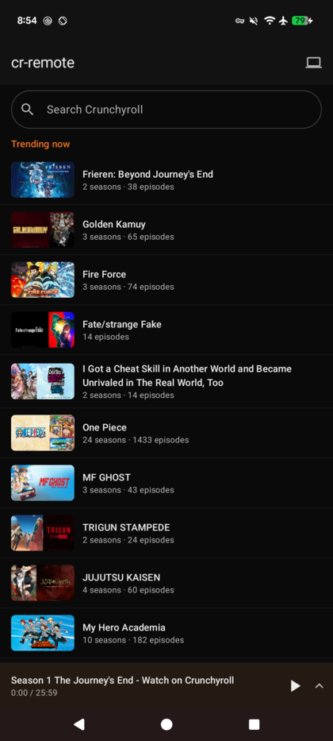
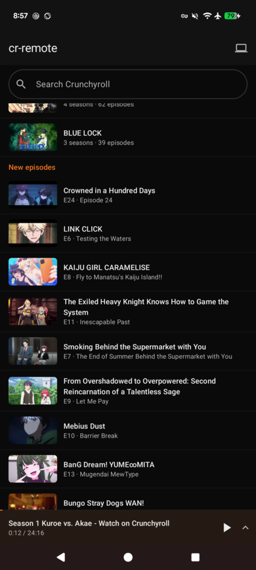
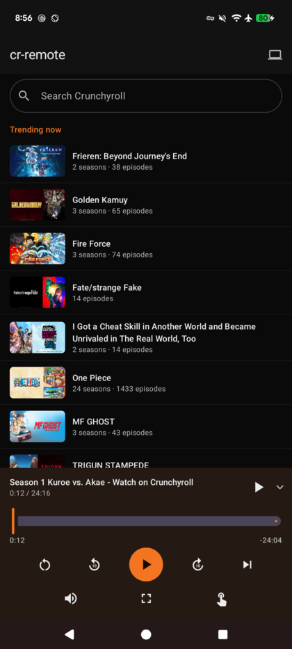

# cr-remote

**An Android remote for Crunchyroll.** Search shows on your phone, pick an
episode, and drive playback on a PC.

<p align="center">
  
  
  
</p>

```
Android app ──HTTP :8774──> cr-broker <──WS :8775── browser extension (any PC)
  search / browse / control   (dumb router)         ├─ Crunchyroll API
                                                    └─ the page's <video>
```

## Why it works this way

Crunchyroll's video is **Widevine-DRM'd**, so no third-party app can decode the
stream. A Crunchyroll remote therefore cannot be a player — it has to drive
something that already has a licensed one. Here that is a small browser
extension.

A useful consequence: because the extension runs inside a logged-in
`crunchyroll.com` page, it reuses **the site's own session cookie**. No
Crunchyroll credentials are stored on the phone, in the broker, or on disk
anywhere.

See [docs/ARCHITECTURE.md](docs/ARCHITECTURE.md) for the full picture.

## Features

- Search the Crunchyroll catalogue, browse seasons and episodes
- Home screen opens on **Trending now** and **New episodes**
- Resume markers — how far into each episode you already are
- Full transport: play/pause, scrub, ±10s, restart, next episode, mute, volume
- **Real player fullscreen**, not F11 (see below)
- One-tap **"Are you still watching?"** dismissal
- Drive **several PCs** from one phone; pair **several phones** to one broker
- Live position updates, so the scrubber tracks without polling

## Quick start

```bash
git clone <your-repo-url> cr-remote && cd cr-remote

# 1. Broker (once, on an always-on machine)
./broker/install.sh

# 2. Extension — chrome://extensions → Developer mode → Load unpacked → extension/
#    then set broker ws://<host>:8775 and paste the token it printed

# 3. App
adb install -r dist/cr-remote-1.0.0-debug.apk
#    then open http://<host>:8774/pair on the phone and tap the button
```

Full instructions: **[docs/SETUP.md](docs/SETUP.md)**

## Requirements

| Component | Needs |
|---|---|
| Broker | Python 3.11+, `websockets` |
| Controlled PC | Chrome / Chromium / Edge, signed in to Crunchyroll |
| Phone | Android 8.0+ (API 26) |
| Network | A private network reaching all three — [Tailscale](https://tailscale.com) is the intended setup |

A Crunchyroll account is required. Premium content needs a premium account —
this project does not bypass anything.

## How the pairing key works

Everything hangs off one shared secret, generated by the broker the first time it
starts:

```bash
cat ~/.config/cr-remote/token      # e.g. xQ7kP2mNvR4tY8wZ1aB3cD5eF6gH9jKl
```

It is 24 random bytes, URL-safe base64, written `0600`. Nothing else is ever
generated — there is no per-device key, no registration step, no account.

### What holds a copy

| Holder | Stored where | How it gets there |
|---|---|---|
| Broker | `~/.config/cr-remote/token` | created on first run |
| Extension | `chrome.storage.local` | you paste it into the options popup |
| Android app | `DataStore` (app-private) | the `/pair` deep link, or typed in |

Every device uses the **same** token. There is no limit on how many.

### What it is actually for

The token proves *"whoever is calling is allowed to drive this browser"*. That's
it. Concretely:

- The extension sends it when dialling the broker. Wrong token → the WebSocket is
  closed with code `4401` and the browser never registers.
- The phone sends it as `Authorization: Bearer <token>` on every API call. Wrong
  token → `401`, and nothing is forwarded.

### What it is *not*

**It is not a security boundary.** The traffic is plain HTTP and WebSocket, so
the token crosses the network in cleartext. Anyone who can both reach the broker
and read that traffic can replay it.

The actual boundary is **the network**: the broker binds only loopback and the
Tailscale address, never `0.0.0.0`. Tailscale provides the encryption and identity;
the token is a second latch so that a random process on a machine you already
trust cannot quietly start driving your browser.

> **Do not port-forward the broker.** With the token, an attacker can navigate
> your browser and read what you are watching. Without network isolation, the
> token alone is not enough.

Note that the token grants **no access to Crunchyroll**. Your Crunchyroll session
never leaves the browser (see [ARCHITECTURE.md](docs/ARCHITECTURE.md)), so a
leaked token cannot be used to log in as you.

### Rotating it

```bash
rm ~/.config/cr-remote/token
systemctl --user restart cr-broker
cat ~/.config/cr-remote/token      # new value
```

Every device is now locked out and must be re-paired: update the extension's
options, and re-run the `/pair` link on each phone. There is no way to revoke one
device without revoking all of them — a deliberate simplification for a
single-household tool.

---

## How pairing works

Pairing only ever means *"here is the broker's address, and here is the token"*.
Both sides need the same two facts.

### Pairing a browser

`chrome://extensions` → Developer mode → **Load unpacked** → `extension/`, then
click the extension icon and fill in the broker (`ws://<host>:8775`), the token,
and a name for the PC. **Save & connect** stores them in `chrome.storage.local`
and immediately dials out.

The status line and the toolbar badge tell you where you stand: green/no badge
means connected, a red `!` means it is not.

### Pairing a phone — three routes

**1. The `/pair` page (recommended).** On the phone, open
`http://<broker-host>:8774/pair` and tap **Pair this phone**. The page is served
by the broker itself and contains a deep link:

```
crremote://pair?broker=<host>:8774&token=<token>
```

The app registers that scheme, so the tap hands it both values at once and you
never type a 32-character token on a phone keyboard. The page is unauthenticated
on purpose — being able to load it already proves you are on the private network.

**2. By hand.** Open the app and type the broker host and token on the pairing
screen. The host field is forgiving: `mypc`, `mypc:8774` and
`http://mypc:8774` all normalise to the same thing.

**3. Over adb.** Useful for setting up several devices:

```bash
adb shell am start -a android.intent.action.VIEW \
  -d "crremote://pair?broker=<host>%3A8774&token=$(cat ~/.config/cr-remote/token)"
```

Verify it landed (debug builds only):

```bash
adb shell run-as uk.krodity.crremote \
  cat files/datastore/cr-remote.preferences_pb | strings
```

---

## How the connection works

Nothing listens on the phone, and an extension cannot listen on a port at all.
So **both ends dial out to the broker**, and the broker introduces them.

```
  extension                     broker                      phone
      │                            │                          │
      │ ws://host:8775/host?token= │                          │
      ├───────────────────────────▶│ validates token          │
      │                            │ registers host           │
      │◀───────────────────────────┤ ping every 20s           │
      │                            │                          │
      │  {"type":"status",...}     │                          │
      ├───────────────────────────▶│ caches last status       │
      │                            │                          │
      │                            │◀─────────────────────────┤ POST /api/rpc
      │                            │   Bearer <token>         │ {"method":"search"}
      │ {"id":7,"method":"search"} │                          │
      │◀───────────────────────────┤                          │
      │ {"id":7,"result":{...}}    │                          │
      ├───────────────────────────▶├─────────────────────────▶│ {"host":…,"result":…}
```

**1. The browser registers.** On load, the extension opens a WebSocket to
`ws://<host>:8775/host?token=…&name=…&id=…`. The `id` is a UUID fragment kept in
`chrome.storage`, so the same browser keeps a stable identity across restarts and
does not pile up duplicate entries.

**2. The broker tracks it as a "host".** Each connected browser is one host.
`GET /api/hosts` lists them, newest first.

**3. The phone calls in.** Every action is one `POST /api/rpc`. If the phone
names a `host`, that browser is used; if it does not, the broker picks the **most
recently connected** one — which is almost always the machine you just sat down
at. The monitor icon in the app's top bar overrides this.

**4. The broker forwards and waits.** It assigns an incrementing id, sends the
call over that host's socket, and holds the HTTP request open until the matching
reply arrives. Calls time out after 25s (`CR_BROKER_RPC_TIMEOUT`). Errors are
flattened into one shape, so `no browser connected` (503), `the extension raised
an error` (502) and `bad token` (401) all surface as readable text in the app.

**5. Status flows the other way unasked.** Roughly every 2s the extension pushes
the player state up. The broker caches it and the phone polls cheaply, so the
scrubber tracks without either side hammering the other.

### When things drop

- **Broker restarts** → the extension's socket closes, it reconnects with
  exponential backoff (2s → 60s). Verified: restarting the service brings the
  browser back on its own within seconds.
- **Browser closes** → the host disappears from `/api/hosts` immediately. The app
  shows a red badge on the PC-picker.
- **Service worker evicted** — MV3 workers are killed when idle. Websocket
  traffic and the broker's 20s ping normally prevent it, and a 1-minute
  `chrome.alarms` heartbeat revives and reconnects it otherwise.
- **Phone sleeps** → nothing to do; it simply resumes polling on wake.

### Multiple devices

Hosts and remotes are independent. Several browsers can be connected at once and
the phone chooses between them; several phones can share one token and all drive
the same browser. The broker imposes no limit on either.

---

## Documentation

| | |
|---|---|
| [SETUP.md](docs/SETUP.md) | Install and pairing, step by step |
| [ARCHITECTURE.md](docs/ARCHITECTURE.md) | How it works, and why it is shaped this way |
| [PROTOCOL.md](docs/PROTOCOL.md) | HTTP + WebSocket API, and the Crunchyroll endpoints used |
| [TROUBLESHOOTING.md](docs/TROUBLESHOOTING.md) | Every trap found while building it |

## Layout

```
broker/       cr_broker.py — the rendezvous service (stdlib + websockets)
  systemd/    user service unit
  install.sh  installs and starts it
extension/    MV3 extension: cr-api.js (Crunchyroll), background.js (broker
              link + RPC dispatch), content.js (the <video> element)
android/      Kotlin + Compose app
dist/         prebuilt, debug-signed APK + SHA256SUMS
docs/         the documents above
```

## Two notes on the tricky bits

**Fullscreen.** `video.requestFullscreen()` from an extension fails with
*Permissions check failed* — element fullscreen needs a real user gesture, and a
message from a phone is not one. Synthetic `KeyboardEvent`s do not help either.
The extension therefore attaches `chrome.debugger` and dispatches a **trusted `f`
keypress**, driving Crunchyroll's own player fullscreen. Cost: a
*"started debugging this browser"* infobar while attached.

**Security.** The broker binds loopback and the Tailscale address only, and the
pairing token is a shared secret, not a security boundary — the private network
is. **Do not expose the broker to the internet**: anyone who reaches it with the
token can drive your browser.

## Status

Working and in daily use. Verified end-to-end: search, browse, trending, new
episodes, resume points, play, pause, seek, ±10s, restart, mute, next episode,
player fullscreen, and multi-device pairing.

Not implemented: queueing, watchlist, subtitle/audio track selection, casting to
anything other than a browser.

Next up: **QR pairing** — scan a code on the PC instead of opening the `/pair`
URL. See [TODO.md](TODO.md).

## License

MIT — see [LICENSE](LICENSE).

Not affiliated with or endorsed by Crunchyroll. It drives the official web player
using your own logged-in session and does not circumvent DRM or access controls.
